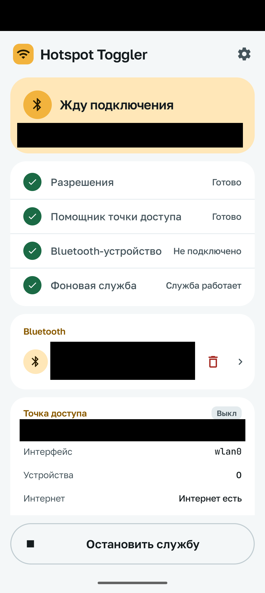
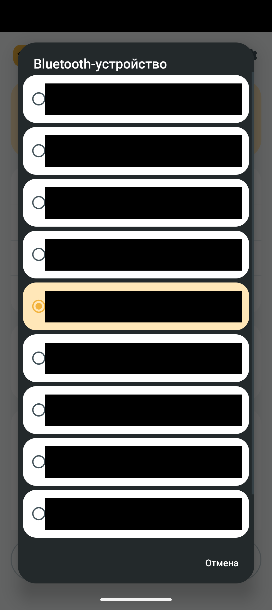
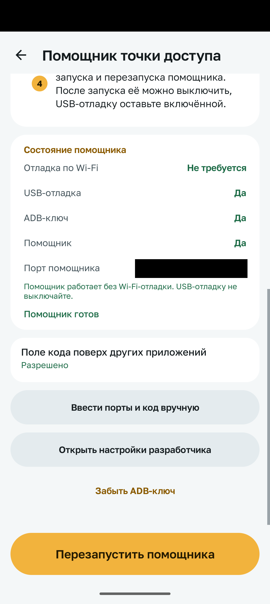
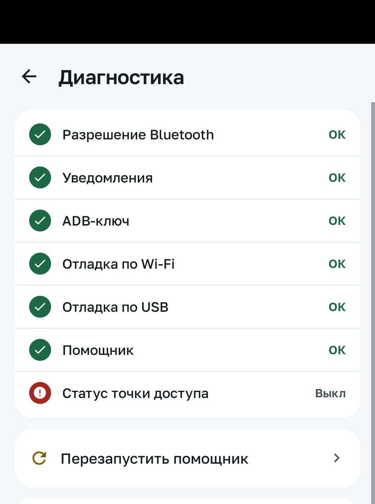

# Hotspot Toggler

Небольшое Android-приложение для Android 16, которое автоматически включает системную точку доступа при подключении выбранного Bluetooth-устройства и выключает её после отключения.

Приложение не требует root и Shizuku. Для управления системным tethering используется небольшой helper, запускаемый через отладку телефона.

> **Режим работы:** Wi-Fi-отладка нужна только для запуска/перезапуска helper. После запуска её можно выключить, а USB-отладку нужно оставить включённой — она не даёт Android остановить helper.

## Скриншоты

<p align="center">
  
  
  
  
</p>

## Возможности

- Выбор одного Bluetooth-устройства-триггера из списка сопряжённых устройств.
- Автоматическое включение точки доступа при подключении выбранного устройства.
- Автоматическое выключение точки доступа после отключения с настраиваемой задержкой (0–120 секунд).
- Выключение только той точки доступа, которую включило приложение; включённая вручную остаётся.
- Статус точки доступа: включена/выключена, SSID, интерфейс, клиенты, интернет.
- Общая скорость hotspot-интерфейса и график за последние 60 секунд.
- Список подключённых клиентов, если прошивка отдаёт MAC/IP/имя.
- Уведомление foreground-службы и запуск после перезагрузки.
- Диагностика: проверки, журнал, копирование/отправка лога.
- Тёмная/светлая/системная тема.
- Гибридный режим доступа: Wi-Fi-отладка только для запуска helper, USB-отладка для его живучести.

## Как это работает

Android 16 не разрешает обычным приложениям включать системную точку доступа. `TetheringManager.startTethering` требует `TETHER_PRIVILEGED` — это `signature|privileged` разрешение, которое нельзя выдать обычному приложению через `pm grant`.

Схема:

```text
Hotspot Toggler (app UID)
        │
        │ Bluetooth ACL
        ▼
TogglerService
        │
        │ TCP 127.0.0.1:<port> + token
        ▼
helper (shell UID 2000)
        │
        │ ITetheringConnector
        ▼
Системная точка доступа
```

1. Пользователь один раз сопрягает приложение с собственной отладкой телефона по 6-значному коду.
2. Приложение через Kadb подключается к adbd на `127.0.0.1` и запускает helper через `app_process`.
3. Helper работает от имени shell и вызывает tethering binder.
4. Приложение общается с helper по TCP-loopback с случайным токеном.
5. Helper слушает только loopback; снаружи он недоступен.

Подробнее: [docs/ARCHITECTURE.md](docs/ARCHITECTURE.md).

### Почему helper зависит от отладки

Helper — процесс, запущенный из adb shell. Android помещает его в cgroup adbd-сессии. Если выключить отладку, adbd завершает сессию и helper останавливается.

Поэтому используется гибридный режим:

- **Wi-Fi-отладка** — включить на 1–2 минуты, чтобы запустить или перезапустить helper;
- **USB-отладка** — оставить включённой, чтобы Android не остановил helper;
- после запуска Wi-Fi-отладку можно выключить.

Если helper остановлен, приложение само поднимет его, когда Wi-Fi-отладка снова включена. Повторное сопряжение по коду не нужно.

## Требования

- Android 16 (API 36) или новее; `minSdk 34`, `targetSdk 36`.
- Телефон с включённой отладкой по USB.
- Wi-Fi-отладка — для первичной настройки и перезапуска helper.
- Разрешения: «Устройства рядом» (Bluetooth), «Уведомления».
- Для отображения поля кода поверх окон (опционально): «Поверх других приложений».

## Установка

Готовый APK: [GitHub Releases](https://github.com/hongkilldong/HotspotToggler/releases).

```text
adb install -r HotspotToggler-1.0.apk
```

Пакет: `com.hongkilldong.hotspottoggler`.

## Первая настройка

1. Установите APK.
2. Выдайте разрешения «Устройства рядом» и «Уведомления».
3. В настройках разработчика включите **«Отладка по USB»** и **«Отладка по Wi-Fi»**.
4. Откройте в приложении «Помощник точки доступа» → «Настроить помощника».
5. Приложение откроет настройки разработчика. Откройте «Отладка по Wi-Fi» → «Подключить устройство с помощью кода подключения» (на Pixel — «Pair device with pairing code»).
6. В шторке появится уведомление Hotspot Toggler с полем ввода. Введите 6-значный код и нажмите «Отправить», не закрывая системное окно.
7. Выберите Bluetooth-устройство в приложении.
8. Нажмите «Запустить службу».
9. После успешной активации Wi-Fi-отладку можно выключить. **USB-отладку оставьте включённой.**

При подключении выбранного Bluetooth-устройства точка доступа включится автоматически.

### После перезагрузки

Android сбрасывает Wi-Fi-отладку. После загрузки:

1. Включите Wi-Fi-отладку на 1–2 минуты.
2. Приложение само найдёт сохранённый ADB-ключ, подключится и запустит helper.
3. Wi-Fi-отладку можно снова выключить.

USB-отладка сама запустить helper не может — она только не даёт Android остановить уже запущенный процесс.

### Если активация не начинается

После удаления ADB-ключа нажмите «Настроить помощника». Приложение откроет настройки разработчика. Откройте «Отладка по Wi-Fi» → «Подключить устройство с помощью кода подключения» и введите код в уведомление.

Подробнее: [docs/ACTIVATION.md](docs/ACTIVATION.md).

## Навигация и Back

Кнопки приложения открывают настройки разработчика в задаче Hotspot Toggler. Back с корневого экрана Developer options возвращает в приложение.

Android не позволяет приложению перехватить Back внутри чужого Activity. Поэтому Back с вложенного экрана Settings (например, «Отладка по Wi-Fi») сначала возвращает на предыдущий экран настроек. Для быстрого возврата в уведомлении помощника есть действие **«Вернуться в приложение»**.

## Безопасность

- **USB-отладка** даёт shell-доступ любому авторизованному USB-хосту. Не подключайте телефон к незнакомым компьютерам и периодически отзывайте авторизации ADB.
- **Wi-Fi-отладка** дополнительно открывает adbd в сети. Включайте её только в доверенной сети и только на время запуска helper.
- Helper слушает только `127.0.0.1` и защищён случайным токеном.
- Root не требуется; приложение не использует Shizuku.
- Если нужен режим вообще без отладки, единственный надёжный путь — root-helper или привилегированная установка.

Подробнее: [docs/SECURITY.md](docs/SECURITY.md).

## Сборка

Требуется JDK 17+ (проверено на JDK 25), Android SDK platform 37 и Gradle wrapper 9.8.2.

```powershell
cd HotspotToggler
.\gradlew.bat :app:assembleDebug
```

APK: `app/build/outputs/apk/debug/app-debug.apk`.

Release-сборка подписывается debug-ключом (для личной установки):

```powershell
.\gradlew.bat :app:assembleRelease
```

APK: `app/build/outputs/apk/release/app-release.apk`.

### CI

GitHub Actions собирает debug APK при push и pull request: `.github/workflows/android.yml`.

## Структура проекта

```text
app/src/main/java/com/hongkilldong/hotspottoggler/
  ui/          экраны и компоненты интерфейса
  service/     foreground-служба, уведомления, boot receiver
  bt/          Bluetooth-устройства и ACL-события
  activation/  Kadb-сопряжение, mDNS, запуск helper, overlay
  helper/      shell-helper, tethering, клиенты, счётчики
docs/          архитектура, активация, диагностика, безопасность
```

## Ограничения

- Скорость показывается общая по точке доступа; per-client счётчики без root недоступны.
- Список клиентов зависит от прошивки.
- Если оператор блокирует tethering, приложение покажет ошибку.
- Wi-Fi-отладка нужна для запуска/перезапуска helper; после перезагрузки её нужно включить один раз.
- USB-отладка должна оставаться включённой, пока helper работает.
- Прямой deep-link на экран Wireless debugging на Nothing OS заблокирован системными настройками.
- Приложение не является системным и не использует root/Shizuku.

## Диагностика

Настройки → Диагностика:

- проверка разрешений, ADB-ключа, отладки по USB/Wi-Fi, helper и статуса точки;
- журнал приложения;
- копирование/отправка журнала;
- перезапуск helper.

Если helper не запускается, проверьте:

- включена ли Wi-Fi-отладка (для запуска/перезапуска);
- включена ли USB-отладка (чтобы Android не остановил helper);
- не отозвана ли авторизация ADB;
- не заблокирован ли запуск `app_process` прошивкой.

Подробнее: [docs/TROUBLESHOOTING.md](docs/TROUBLESHOOTING.md).

## English summary

**Hotspot Toggler** is a small Android 16 app that turns on the phone's system Wi-Fi hotspot when a selected Bluetooth device connects, and turns it off after disconnect.

It does not use root or Shizuku. Android does not allow normal apps to call `TetheringManager.startTethering` (`TETHER_PRIVILEGED` is a `signature|privileged` permission), so the app runs a small shell helper through the phone's own ADB.

**Hybrid access mode:** wireless debugging is needed only to start or restart the helper. After the helper is running, wireless debugging can be turned off; USB debugging must stay on so Android does not kill the helper. If the helper stops, enable wireless debugging again — the app restarts it automatically using the saved ADB key.

Features: Bluetooth trigger selection, automatic hotspot on/off, auto-off delay, hotspot status, clients, total speed graph, diagnostics, light/dark/system theme.

Requirements: Android 16+, USB debugging on, wireless debugging for helper start/restart.

Build: `./gradlew :app:assembleDebug`. Release APK: GitHub Releases.

Documentation: [architecture](docs/ARCHITECTURE.md), [activation](docs/ACTIVATION.md), [troubleshooting](docs/TROUBLESHOOTING.md), [security](docs/SECURITY.md), [development](docs/DEVELOPMENT.md).

## Лицензия

Copyright (C) 2026 hongkilldong.

Проект распространяется под **GNU General Public License v3.0**. Полный текст: [LICENSE](LICENSE).

Сторонние компоненты и шрифты: [THIRD_PARTY_NOTICES.md](THIRD_PARTY_NOTICES.md).
